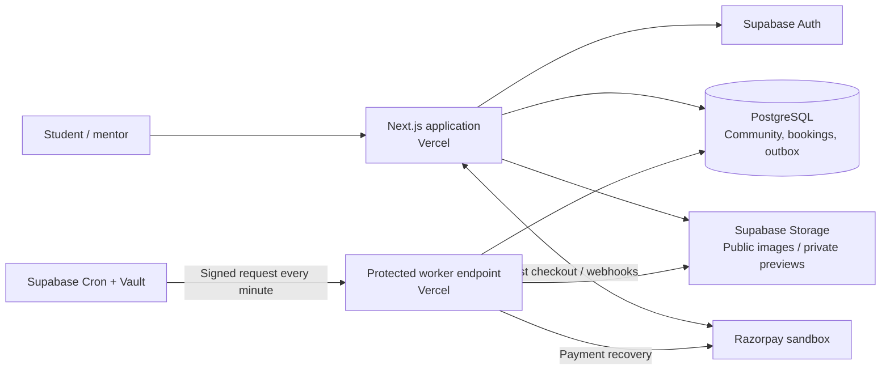

<div align="center">

# Nexus

### A question. A person. A next step.

A mentorship platform for engineering students to share where they are stuck, find the right mentor, and work through the approach together.

[](https://github.com/Alchemist-10/nexus_submitted/actions/workflows/ci.yml)


**[Explore the live demo](https://nexus-mentorship-akshay-vss-projects.vercel.app)** · [Architecture](#architecture) · [Quick start](#quick-start) · [Documentation](#documentation)

</div>

---

## Overview

Nexus connects engineering students with people who can help them reason through coding problems, project decisions, academic concepts, and career questions. A learning request captures the problem and the exact point of confusion; relevant mentors can then offer an explanation or continue the conversation in a one-to-one session.

Each student receives **one free introductory call per mentor**. Completing that introduction unlocks optional follow-up bookings. The community feed gives those conversations context, while profiles, contributions, and completed-session ratings help students choose whom to approach.

> **Portfolio release:** the deployed application includes sample accounts and content. Payments use Razorpay test mode, and notification emails are stored as private previews. No real charges or automated mentor payouts are enabled.

## The experience

1. **Share the context.** Publish a learning request with text, code, topic tags, and up to three images.
2. **Find a relevant mentor.** Explore recommendations based on expertise, contribution evidence, and available introductory slots.
3. **Book a conversation.** Choose a time; Nexus checks eligibility and schedule conflicts before confirming the session.
4. **Work through it together.** Open the mentor-provided meeting link through the private session page.
5. **Reflect and continue.** Once the mentor ends the session, leave a rating or book a follow-up through sandbox checkout.

## Product capabilities

| Area                        | Capabilities                                                                                                                                         |
| --------------------------- | ---------------------------------------------------------------------------------------------------------------------------------------------------- |
| **Learning requests**       | Text and image posts, contextual problem descriptions, category and topic filters, search, and paginated latest/top/unanswered feeds.                |
| **Community contributions** | Answers, reversible upvotes, author-accepted explanations, owner deletion, and private reports for manual review.                                    |
| **Mentor discovery**        | Public expertise profiles, topic-based recommendations, availability previews, and session-rating summaries.                                         |
| **Booking and sessions**    | One free introduction per student–mentor pair, timezone-aware scheduling, conflict protection, cancellation, private meeting access, and completion. |
| **Follow-up checkout**      | Mentor-set INR prices, ten-minute slot reservations, verified Razorpay test payments, cancellation refunds, and recovery jobs.                       |
| **Notifications**           | A private inbox, unread counts, booking updates, 24-hour and 15-minute reminders, and a mentor alert when a meeting link is missing.                 |
| **Member workspace**        | Individual profiles, contribution history, illustrated or uploaded avatars, session dashboards, and light/dark themes.                               |

## Architecture

Nexus uses Next.js for the web application and server-side orchestration, with Supabase providing authentication, PostgreSQL, and object storage. Booking rules and authorization are enforced in the database. Background work is persisted in PostgreSQL and processed through a protected endpoint on Vercel.



| Layer                  | Technology                                                      | Responsibility                                                                          |
| ---------------------- | --------------------------------------------------------------- | --------------------------------------------------------------------------------------- |
| Application            | Next.js 16 App Router, React 19, TypeScript                     | Server-rendered pages, server actions, authenticated workflows, and API routes.         |
| Data and identity      | Supabase Auth, PostgreSQL, Supabase Storage                     | Accounts, row-level access, transactional booking rules, posts, and uploaded assets.    |
| Background processing  | PostgreSQL outbox, Supabase Cron, Vercel Functions              | Notification delivery, reminder scheduling, payment reconciliation, and refunds.        |
| Payments               | Razorpay Orders, Checkout, and webhooks                         | Server-verified sandbox payments in INR.                                                |
| Validation and quality | Zod, Node.js test runner, PGlite, PostgreSQL 17, GitHub Actions | Input validation, SQL integration tests, concurrent-connection tests, and build checks. |

### Engineering decisions

- **Atomic booking transactions.** A booking reserves the slot, the free-call allowance, and both participants together. PostgreSQL exclusion constraints prevent overlapping reservations even when someone acts as a student in one session and a mentor in another.
- **Retry-safe operations.** Stable request keys return the existing booking instead of creating duplicates. Payment callbacks and webhook replays are checked against stored provider records.
- **Transactional notifications.** Booking events create inbox records and delivery jobs in the same transaction. Workers use exclusive leases, bounded retries, and conditional acknowledgements; cancellation suppresses outstanding reminders.
- **Server-verified payments.** A paid booking is confirmed only after captured payment is verified against its stored order, amount, and currency. Expired holds and late captures have explicit recovery/refund paths.
- **Private session access.** Row-level security restricts bookings and inbox entries to their participants or recipients. Meeting URLs are retrieved through an authorized, time-limited flow; service credentials remain server-only.
- **Authenticated scheduling.** Scheduled requests use short-lived HMAC signatures and single-use nonces. The reusable worker secret stays in Vault and Vercel configuration rather than entering the HTTP request queue.

## Quick start

### Prerequisites

- Node.js **22.12 or newer**; the deployment and CI use Node.js 22.
- npm.
- A Supabase database with the repository migrations applied. Use a separate hosted development project or the local Docker-based stack below.

### 1. Install

From a fresh checkout:

```bash
git clone https://github.com/Alchemist-10/nexus_submitted.git nexus
cd nexus
npm ci
cp .env.example .env.local
```

On Windows PowerShell, `Copy-Item .env.example .env.local` is also available. When working in an existing checkout, keep its configured `.env.local`.

### 2. Connect Supabase

<details>
<summary><strong>Local development with Docker</strong></summary>

Start Docker, then run these commands from the repository root:

```bash
npx supabase start
npx supabase db reset
npx supabase status
```

The reset command recreates the **local development database** from migrations and loads [local sample accounts and availability](supabase/seed.sql). Use a disposable local stack; keep the seed out of hosted environments.

Copy the local API URL and public publishable/anon key into `.env.local`. Local Studio is available at `http://localhost:54323`, and the local email viewer at `http://localhost:54324`.

</details>

<details>
<summary><strong>A separate hosted development project</strong></summary>

1. Create your own Supabase project and apply [the migrations](supabase/migrations/) in timestamp order to that new database. Keep an existing project’s migration history intact.
2. Add its API URL and publishable key to `.env.local`.
3. Set the development Site URL to `http://localhost:3000` and allow `http://localhost:3000/auth/callback` in Supabase Auth.
4. Enable email/password sign-up and email confirmation. Use an appropriate email sender for addresses outside your project team.

The hosted scheduler is configured separately from application migrations; see the [deployment guide](docs/deployment.md). Do not apply production scheduling operations to a development project without configuring its target and credentials.

</details>

The core application uses:

```dotenv
NEXT_PUBLIC_APP_URL=http://localhost:3000
NEXT_PUBLIC_SUPABASE_URL=your_supabase_api_url
NEXT_PUBLIC_SUPABASE_PUBLISHABLE_KEY=your_public_publishable_key
```

The full configuration template is [`.env.example`](.env.example). Keep private values in `.env.local` or your hosting environment. Only public client configuration belongs in `NEXT_PUBLIC_` variables.

### 3. Start the application

```bash
npm run dev
```

Open **[localhost:3000](http://localhost:3000)**. Use separate browser sessions for the mentor and student when testing a complete booking journey.

### Optional: background jobs and sandbox checkout

| Capability                  | Configuration                                                                                                                                                            |
| --------------------------- | ------------------------------------------------------------------------------------------------------------------------------------------------------------------------ |
| Notification inbox          | Created by booking events; no email provider is required. Scheduled reminders also require a running worker.                                                             |
| Local notification previews | Set the server-only `SUPABASE_SECRET_KEY`, keep `NOTIFICATION_TRANSPORT=preview`, and run `npm run notifications:watch`.                                                 |
| Razorpay test checkout      | Add `RAZORPAY_KEY_ID` with an `rzp_test_` prefix, `RAZORPAY_KEY_SECRET`, `RAZORPAY_WEBHOOK_SECRET`, and `SUPABASE_SECRET_KEY`. Complete the sandbox configuration below. |
| Hosted background jobs      | Configure private preview storage, the protected worker endpoint, and signed Cron dispatch using the deployment guide.                                                   |

<details>
<summary><strong>Sandbox payment configuration</strong></summary>

1. Generate API credentials in Razorpay **Test Mode**. Live key IDs are refused by the application.
2. Set `RAZORPAY_WEBHOOK_SECRET` to a private random value, then use that same value when configuring the webhook in Razorpay.
3. Set the webhook URL to `https://YOUR_APP_DOMAIN/api/payments/razorpay/webhook` and subscribe to `payment.captured`, `payment.failed`, `order.paid`, `refund.processed`, and `refund.failed`. Local testing needs a public HTTPS development endpoint; Razorpay cannot deliver directly to localhost.
4. Enable automatic payment capture for the test integration. Authorization alone does not confirm a booking.
5. Run the payment recovery worker alongside local development:

```bash
npm run payments:work
```

This processes one batch and exits. Repeat it for unattended reconciliation and refund retries, or configure the hosted scheduler in the [deployment guide](docs/deployment.md). For the complete checkout journey, finish a free introduction with the same mentor before booking a paid follow-up.

The [payment verification record](docs/payments-verification.md) distinguishes provider simulations from actual sandbox transactions and webhook deliveries.

</details>

For an immediate reminder demonstration:

```bash
npm run notifications:demo
```

This runs the actual booking, queue, and worker code in an isolated in-memory database and accelerates reminder deadlines. It writes local previews without changing hosted bookings or sending email.

## Development and verification

```bash
npm run check
```

This runs type checking, linting, formatting checks, application/SQL tests, payment-flow tests, and a production build.

[GitHub Actions](https://github.com/Alchemist-10/nexus_submitted/actions/workflows/ci.yml) also runs the suite against a disposable **PostgreSQL 17** service. Independent-connection race tests execute there; they are skipped in the single-backend PGlite run. Tests cover authorization, booking conflicts and rollback, repeat requests, ratings, notification recovery, payment verification, and signed worker replay protection.

Provider mocks, actual sandbox checks, and deployed browser checks are documented separately in the verification records. These checks establish tested behavior; they are not a claim of production traffic capacity or public adoption.

## Repository structure

```text
src/
  app/                  Pages, layouts, auth callbacks, and API routes
  components/           Reusable interface and form components
  features/             Auth, community, mentorship, bookings, payments,
                        profiles, notifications, and worker orchestration
  lib/                  Validation, database types, sessions, and clients
  proxy.ts              Supabase session-cookie refresh
supabase/
  migrations/           Versioned application schema and database functions
  operations/           Hosted-only scheduler setup
  seed.sql              Local development fixtures
scripts/                Background workers and local demonstrations
tests/                  SQL integration, workflow, and validation tests
docs/                   Deployment, design, and verification records
.github/workflows/      Continuous integration
```

## Documentation

| Guide                                                           | Contents                                                                                                         |
| --------------------------------------------------------------- | ---------------------------------------------------------------------------------------------------------------- |
| [Deployment and operations](docs/deployment.md)                 | Hosted architecture, environment configuration, signed scheduling, deployment checks, and free-tier limitations. |
| [Booking and authorization](docs/verification.md)               | Transactional reservations, participant access, idempotency, and concurrency verification.                       |
| [Community and recommendations](docs/community-verification.md) | Posts, images, answers, votes, topic matching, and access policies.                                              |
| [Payments](docs/payments-verification.md)                       | Sandbox checkout, capture verification, webhook handling, refunds, and recovery.                                 |
| [Notifications](docs/notifications-verification.md)             | Inbox behavior, timing rules, local previews, retries, and delivery limits.                                      |
| [Profiles](docs/profiles-verification.md)                       | Public identity, avatars, contribution history, and owner-only editing.                                          |
| [Session completion](docs/session-ending-verification.md)       | Mentor-controlled completion and meeting-access transitions.                                                     |
| [Ratings](docs/ratings-verification.md)                         | Completed-session eligibility, immutable learner ratings, and public summaries.                                  |

## Scope and next steps

The current release is a deployed portfolio demonstration. Mentor recommendations use explainable topic and contribution signals. Video calls use external meeting providers; the mentor ends the Nexus session explicitly to unlock rating. Payment flows remain sandbox-only, and notification email delivery remains in preview mode.

The next priorities are:

- Password recovery and confirmation-email resend.
- Shared publishing/upload quotas and mentor/moderation controls.
- Error monitoring, broader browser regression coverage, and reproducible synthetic load benchmarks.

See the [deployment guide](docs/deployment.md) for current operational constraints, including free-tier availability and GitHub auto-deployment setup.
